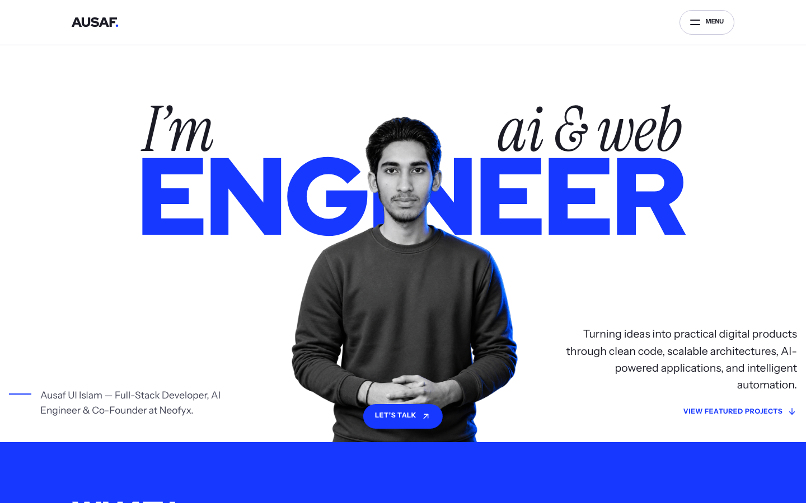

# AUSAF. — Personal Portfolio



A production-ready static portfolio for **Ausaf Ul Islam**, a Full-Stack Developer and AI Engineer. The site presents his profile, services, technical skills, education, experience, five featured projects, contact details, and social links.

## Internship Information

| | |
|---|---|
| Organization | Devixo Solutions |
| Program | Web Development Internship Program |
| Task | Task 01: Professional Personal Portfolio Website |
| Student | Ausaf Ul Islam |
| Domain | Web Development |

## Links

- Live website: https://ausaf-portfolio-devixo-internship.vercel.app/
- GitHub repository: https://github.com/ausafulislam/devixo-internship-portfolio
- Submission report (PDF): [report/Portfolio_Report.pdf](report/Portfolio_Report.pdf)
- Design system: [report/design-system/ausaf_design_system.md](report/design-system/ausaf_design_system.md)

## Stack

- HTML5
- CSS3
- Vanilla JavaScript (ES6+)
- Google Fonts: Red Hat Display, Instrument Serif, Instrument Sans

No frameworks, CSS libraries, JavaScript libraries, animation libraries, UI kits, packages, or build tools are used. The shipped interface is **light mode only**.

## Features

- Sticky header with `AUSAF.` wordmark and pill-shaped Menu button
- Floating rounded navigation panel with dimmed, blurred backdrop and visually hidden scrollbar
- Oversized vertical section links with clip-path reveal, staggered entrance, and smooth reverse close
- Accessible menu behavior: Escape to close, backdrop close, focus trapping, scroll locking, and section focus transfer
- Letter-roll hover effect on navigation links and CTAs, with measured character widths for stable letter spacing
- Oversized hero lockup with serif accents, one-line display heading, portrait, and talk CTA
- Services band, about, technical skills, education, experience, featured projects, contact, and footer sections
- Five project cards with local images and verified external links, plus a GitHub CTA card
- Contact form with inline validation and accessible success status
- Scroll reveals and animated about-section stat counters using `IntersectionObserver`
- Active section highlighting in navigation
- Bold card styling and 3D tilt hover on cards; no portrait lift effect
- Responsive layouts for mobile, tablet, laptop, and desktop breakpoints
- `prefers-reduced-motion` support
- Semantic HTML, accessible labels, meaningful alt text, and skip link

## Project Structure

```text
Portfolio/
├── index.html
├── README.md
├── robots.txt
├── sitemap.xml
├── .gitignore
├── css/
│   ├── style.css
│   ├── responsive.css
│   └── animations.css
├── js/
│   ├── script.js
│   ├── navigation.js
│   └── interactions.js
├── assets/
│   ├── icons/
│   │   ├── favicon.svg
│   │   ├── favicon.png
│   │   └── favicon.ico
│   └── images/
│       ├── profile/profile-ausaf.png
│       └── projects/project-01.png ... project-05.png
├── screenshots/
│   ├── desktop/   (hero, sections, navigation, cards, form, full page)
│   └── mobile/    (hero, sections, navigation, cards, form, full page)
└── report/
    ├── Portfolio_Report.pdf
    └── design-system/ausaf_design_system.md
```

## File Responsibilities

- `index.html`: semantic structure, SEO metadata, Open Graph/Twitter tags, JSON-LD, favicon links, and file references.
- `css/style.css`: design tokens, reset, typography, light theme, layout, components, and section styling.
- `css/responsive.css`: mobile, tablet, laptop, and desktop media queries.
- `css/animations.css`: keyframes, transitions, hover effects, reveal states, and reduced-motion handling.
- `js/navigation.js`: floating menu panel, backdrop, close control, stagger state, focus handling, scroll locking, and section navigation.
- `js/interactions.js`: rolling text, measured character spacing, scroll reveals, active section tracking, stat counters, and contact form validation.
- `js/script.js`: shared initialization for navigation and interaction modules.
- `assets/icons/favicon.svg`: scalable `A.` favicon using Red Hat Display, matching the header wordmark.
- `assets/icons/favicon.png` and `favicon.ico`: raster favicon fallbacks.
- `report/Portfolio_Report.pdf`: final submission report.
- `report/design-system/ausaf_design_system.md`: approved design-system reference.

## SEO and Social Sharing

- Descriptive title, meta description, author, robots, and light color-scheme metadata.
- Canonical URL for the deployed site.
- Open Graph and Twitter card metadata using the desktop hero screenshot as the OG image.
- `Person` JSON-LD structured data for Ausaf Ul Islam.
- SVG, PNG, and ICO favicon assets generated from the header wordmark treatment.
- `robots.txt` and `sitemap.xml` for static hosting.

## Run Locally

No build step or dependency installation is required.

```bash
git clone https://github.com/ausafulislam/devixo-internship-portfolio.git
cd devixo-internship-portfolio
```

Open `index.html` directly in a browser, or serve the folder from the project root:

```bash
python -m http.server 8000
```

Then open `http://localhost:8000`.

## Deployment

Upload the repository root to any static host. If deploying under a different domain, update the canonical URL, Open Graph/Twitter URLs, and `sitemap.xml` to match the final production domain.

## Screenshots

| View | Desktop | Mobile |
|---|---|---|
| Hero | [Desktop hero](screenshots/desktop/01-home.png) | [Mobile hero](screenshots/mobile/01-home.png) |
| About | [Desktop about](screenshots/desktop/02-about.png) | [Mobile about](screenshots/mobile/02-about.png) |
| Skills | [Desktop skills](screenshots/desktop/03-skills.png) | [Mobile skills](screenshots/mobile/03-skills.png) |
| Education | [Desktop education](screenshots/desktop/04-education.png) | [Mobile education](screenshots/mobile/04-education.png) |
| Projects | [Desktop projects](screenshots/desktop/05-projects.png) | [Mobile projects](screenshots/mobile/05-projects.png) |
| Contact | [Desktop contact](screenshots/desktop/06-contact.png) | [Mobile contact](screenshots/mobile/06-contact.png) |
| Footer | [Desktop footer](screenshots/desktop/07-footer.png) | [Mobile footer](screenshots/mobile/07-footer.png) |
| Navigation | [Desktop menu](screenshots/desktop/08-navigation.png) | [Mobile menu](screenshots/mobile/08-navigation.png) |
| Project cards | [Desktop cards](screenshots/desktop/09-project-cards.png) | [Mobile cards](screenshots/mobile/09-project-cards.png) |
| Contact form | [Desktop form](screenshots/desktop/10-contact-form.png) | [Mobile form](screenshots/mobile/10-contact-form.png) |

Full-page captures: [desktop](screenshots/desktop/full-page.png) and [mobile](screenshots/mobile/full-page.png).

## Contact

- Email: ausafdev@gmail.com
- Phone: +92 371 3920266
- GitHub: https://github.com/ausafulislam
- LinkedIn: https://linkedin.com/in/ausafulislam
- X: https://x.com/ausafulislam_h
- Fiverr: https://www.fiverr.com/h_ausafulislam

## Notes

- The contact form validates locally and shows a success state; it does not send data to a backend.
- Google Fonts are the only external runtime resource. The rest of the site uses local files.
- The design-system document is retained as the approved reference; the shipped interface intentionally uses only its light palette.
